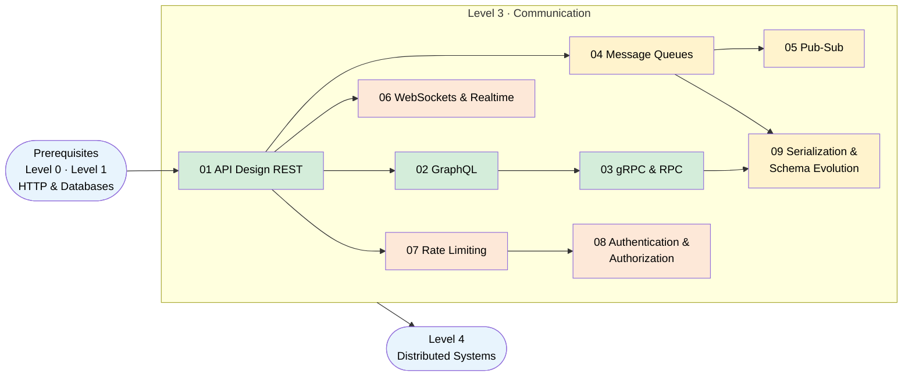

# Level 3 — Communication

> **Theme:** How services talk to clients and each other — the protocols, patterns, and trade-offs that move data across process boundaries.

---

## 🎯 Learning Outcomes

By the end of this level you will be able to:

- Design clean REST APIs with proper verbs, status codes, URL structure, versioning, and pagination
- Explain the over-fetching / under-fetching problem and when GraphQL is the right solution
- Describe the gRPC + Protocol Buffers model and its four streaming modes
- Choose between synchronous RPC and asynchronous messaging based on coupling and latency requirements
- Contrast message queues (point-to-point) with pub/sub (fan-out) and name real platforms for each
- Architect real-time features using the right transport (polling → SSE → WebSockets) and scale stateful connections
- Implement and compare five rate-limiting algorithms and defend your choice in an interview
- Secure APIs end-to-end: sessions vs JWTs, OAuth 2.0 + PKCE, OIDC, SSO/SAML, API keys, mTLS, and RBAC/ABAC authorization
- Pick a serialization format (JSON, Protobuf, Avro, Parquet) and evolve schemas safely with backward/forward compatibility and a schema registry

---

## 🗺️ Topic Roadmap

---

## 📚 Topics

| # | Folder | What You'll Learn | Est. Time |
|---|--------|-------------------|-----------|
| 01 | [API Design & REST](./01-API-Design-REST/README.md) | Resources, HTTP verbs, status codes, URL design, versioning, pagination, idempotency | 45 min |
| 02 | [GraphQL](./02-GraphQL/README.md) | Schema/types, queries/mutations/subscriptions, N+1 problem, DataLoader | 45 min |
| 03 | [gRPC and RPC](./03-gRPC-and-RPC/README.md) | Protocol Buffers, HTTP/2, 4 streaming modes, gRPC vs REST vs GraphQL | 40 min |
| 04 | [Message Queues](./04-Message-Queues/README.md) | Producer→queue→consumer, delivery guarantees, DLQ, competing consumers | 40 min |
| 05 | [Pub/Sub](./05-Pub-Sub/README.md) | Topics, fan-out, push vs pull, event-driven architecture | 35 min |
| 06 | [WebSockets and Real-Time](./06-WebSockets-and-Realtime/README.md) | Polling → SSE → WebSockets, handshake, scaling stateful connections | 45 min |
| 07 | [Rate Limiting](./07-Rate-Limiting/README.md) | Fixed window, sliding window, token bucket, leaky bucket, Redis INCR | 45 min |
| 08 | [Authentication and Authorization](./08-Authentication-and-Authorization/README.md) | Sessions vs JWT, OAuth 2.0 + PKCE, OIDC, SSO/SAML, API keys, mTLS, RBAC/ABAC | 50 min |
| 09 | [Data Serialization and Schema Evolution](./09-Data-Serialization-and-Schema-Evolution/README.md) | JSON vs Protobuf vs Avro, backward/forward compatibility, schema registry, tolerant readers | 45 min |

**Total estimated time: ~6.5 hours**

---

## ✅ Prerequisites

Before starting this level, you should be comfortable with:

- **HTTP basics** — [Level 0 · HTTP and HTTPS](../Level-00-Foundations/06-HTTP-and-HTTPS/README.md)
- **Database fundamentals** — [Level 1 · Databases: SQL vs NoSQL](../Level-01-Building-Blocks/04-Databases-SQL-vs-NoSQL/README.md) and [Level 2 · Indexing](../Level-02-Data-Layer/03-Indexing/README.md)
- **Caching concepts** — [Level 1 · Caching](../Level-01-Building-Blocks/03-Caching/README.md) (optional but helpful for rate limiting)

---

## 🔗 What Comes Next

- **[Level 4 · Distributed Systems](../Level-04-Distributed-Systems/README.md)** — consensus, consistency, idempotency (start with [Idempotency and Exactly-Once](../Level-04-Distributed-Systems/07-Idempotency-and-Exactly-Once/README.md) if retries are on your mind)
- **[Level 7 · Big Data](../Level-07-Big-Data-and-Specialized/README.md)** — the Kafka deep-dive lives in [Stream Processing](../Level-07-Big-Data-and-Specialized/02-Stream-Processing/README.md)

---

## 💡 How to Navigate

Work through topics **1 → 3** first (synchronous communication), then **4 → 5** (async), then **6 → 9** (real-time, control, security, and the data formats that cross every boundary). Each topic README is self-contained with diagrams, trade-off tables, interview tips, and quiz questions.

---

<!-- nav:start -->

⬅️ **Previous level:** [Level 2 — The Data Layer](../Level-02-Data-Layer/README.md) · 🏠 [Curriculum home](../README.md) · ➡️ **Start this level:** [API Design & REST](01-API-Design-REST/README.md)

<!-- nav:end -->
